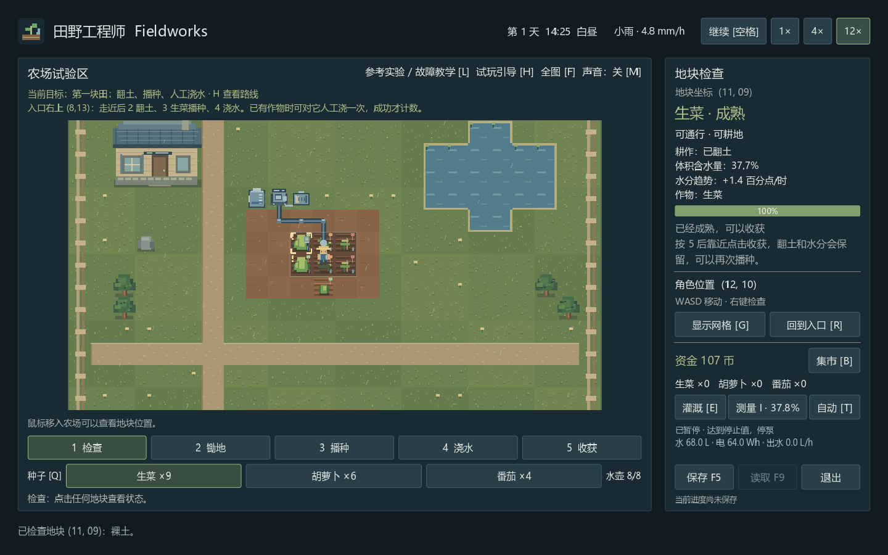

# Harvest Protocol · 田野工程师 Fieldworks

《田野工程师 Fieldworks》项目资料仓库。项目方向为 2D 俯视角像素农业经营，结合设备组装、工程原理学习与农场自动化。

## 项目文档

- [项目总结与设计基准（PDF，18 页）](田野工程师_Fieldworks_项目总结.pdf)

文档整理了已确认的项目方向、视觉基准、玩法循环及初步技术规划。

## 开发流程与进度

先阅读 [开发流程与任务拆解](开发流程与任务拆解.md)，其中记录分步操作、产出、验收条件和实际进度。补充技术基准见 [开发基准](docs/DEVELOPMENT.md)。

开发过程与关键决定见 [工作记录](docs/WORK_LOG.md)，新旧说明的一致性检查见 [文档审核记录](docs/DOCUMENTATION_AUDIT.md)。[项目协作规则](AGENTS.md) 要求每次开工、关键节点和完成时同步记录并回审旧文档。

第 0～14 步已完成，已串起 **第一块田 → 收获销售与补购 → 手动供水 → 校准实验 → 自动控制 → 故障恢复 → 自主调整验证**，完成 C 方案首版像素与界面统一，并通过 Windows 独立试玩包验收。农场显示真实当前目标，H 提供完整路线和经营对照。当前交付 `0.1.0-playtest.1`，后续根据实际试玩反馈修复和规划扩展。实际检查结果见 [验证记录](docs/TEST_REPORT.md)。

当前提供一个手动存档位与上一次有效备份，保存现有农业、经营、设备、测量、自动规则 / 前态 / 日志、专项教学，以及作业 / 模式水电计量和自主调整证据；可选择手动或自动模式。

2026-10-28 已另做一次玩家视角的真实桌面试玩，完成种植经营、基础组装、参考校准与节点连线；引导实际完成 5 / 9 项，完整供水路线仍受本次键盘自动化兼容问题限制。体验问题和建议见 [玩家试玩记录](docs/PLAYER_PLAYTEST_2026-10-28.md)，这些建议尚未实现，不改变第 14 步历史验收结果。

## 当前操作

| 操作 | 按键 / 鼠标 |
| --- | --- |
| 移动角色 | WASD 或方向键 |
| 使用当前工具 | 鼠标左键，耕作需走近目标 |
| 只检查地块 | 鼠标右键，或先按 1 选择检查工具 |
| 检查／锄地／播种／浇水／收获 | 数字键 1／2／3／4／5，或工具栏按钮 |
| 切换种子并进入播种模式 | Q，或点击种子按钮 |
| 补满水壶 | 选择浇水工具，靠近池塘后左键点击水面 |
| 查看悬停地块 | 将鼠标移到地图上 |
| 显示 / 隐藏地块网格 | G，或右侧按钮 |
| 回到农场入口 | R，或右侧按钮 |
| 全图／2× 跟随近景 | F，或农场标题旁按钮；地图内滚轮上近景、下全图 |
| 开／关短操作音 | M，或农场标题旁声音按钮；重启默认关闭 |
| 暂停／继续自然模拟 | 空格，或顶部暂停按钮 |
| 选择模拟速度并继续 | 顶部 1×／4×／12× 按钮 |
| 打开／关闭集市与账本 | B，或右侧集市按钮；Esc 也可关闭 |
| 打开／关闭灌溉组装工作台 | E，或右侧工作台按钮；Esc 也可关闭 |
| 打开／关闭土壤水分测量台 | I，或右侧测量按钮；Esc 也可关闭 |
| 打开／关闭自动灌溉节点图 | T，或右侧自动按钮；Esc 也可关闭 |
| 打开／关闭参考实验与故障教学 | L，或农场标题旁入口；Esc 也可关闭 |
| 打开／关闭连续试玩引导与经营对照 | H，或农场标题旁入口；集市也可进入，Esc 可关闭 |
| 保存农场 | F5，或右侧保存按钮 |
| 读取农场 | F9，或右侧读取按钮 |
| 退出 | 右侧退出按钮，或关闭窗口；有未保存的游玩进度时提示处理 |

检查面板中的坐标从 1 开始；水域、农舍、树木、岩石与边界围栏不可通行。工具作用距离为角色附近约 1.6 格，不能越过障碍操作。

各面板右上统一提供“切换界面”和“返回农场”，并注明“编辑暂停”或“实时观察”。B / E 临时暂停，关闭或切换后恢复进入前的时间；I / T / L / H 保持实际时钟。数字输入获得焦点时先按 Esc 结束编辑，再用字母快捷键切换；下拉菜单先用 Esc 收起，避免同时关闭背后的面板。输入数字时 F5 / F9 仍可使用。

第一次可以直接在入口旁的草地 `(8, 13)` 尝试：按 **2** 左键翻土 → 按 **3** 左键播种 → 按 **4** 左键浇水。种子和水壶余量会随成功操作减少；距离不够时先移动靠近。

浇水前先看右侧水分和生长提示：生菜的适宜范围是 24～38%，人工浇水一次增加 12 个百分点，雨后或较湿时立即浇水可能导致过湿、减慢生长。首项目标需要一次成功人工浇水，可以先等待水分回落；日常照料不必每次播种后都立即浇水。

初始提供 600 币、生菜 12 份、胡萝卜 8 份、番茄 6 份种子，以及可浇 8 次的满水壶。补满水壶固定花费 2 币，水壶已满时不收费。土壤水分数值与人工浇水增量均为原型参数。

## C 方案画面与状态

自然草地、道路、农舍、水源和作物保留颜色；水箱、泵、电池、探头和控制器采用蓝灰像素细节。工程界面共享深色主题、输入样式、标签页和节点样式，中文、体积含水量单位与曲线图例统一。



近景放大画面并跟随角色，仍使用同一地块坐标与操作距离，不允许远程耕作。选中标记为金色；工具悬停的可达 / 不可达反馈分别用绿 / 红，并提供距离或障碍文字，距离可达仍需满足库存、地块等实际工具条件。

| 系统状态 | 呈现 |
| --- | --- |
| 正常供水 | 绿色文字；实际有出水记录且仍运行时出现管线 / 出口水流反馈 |
| 已暂停 | 蓝灰提示、实际出水率 0，暂停信号立即清水流动画并重绘 |
| 正常停止／未组装 | 中性色与明确原因，不冒充故障 |
| 缺水／缺电／设备未齐 | 黄色警告与缺少的资源 |
| 断管／断电／自动测量无效／逻辑断线 | 红色保护或连接故障，并保留具体原因；暂停时仍优先显示问题 |

操作粒子只在成功行为出现，失败保留红色边框反馈。短操作音默认关闭，开启后仅成功翻土、播种、浇水、收获或补水播放，不循环播放机器声。近景和声音是会话设置，不写进 v6 农场存档；读档回全图，声音保留当前会话开关，重启恢复关闭。

截图来自隔离测试存档的真实运行；作物由正常模拟自然生长，节点和故障来自实际状态。[查看同主题的真实自动保护界面](docs/images/c-automation-fault.png)。本步完成首版视觉一致性，PDF 中成熟科技农场的设施密度仍是后续目标。

## 连续试玩路线

农场上方显示当前目标与下一步操作，按 **H** 查看九项目标和“经营对照与周转”。目标从真实地块、收成、账本、供水与教学证据判断；允许提前完成后续项目，不锁定其他功能，打开页面本身不会完成任务。

1. 走到入口右上 `(8,13)`，按 2 翻土、3 播种生菜、4 人工浇水。H 的“定位目标”只选择地块，不传送角色或替你操作。
2. 选择 12×，按地块水分反馈照料；成熟后按 5 收获，在 B 卖出一份生菜得到 18 币，再买一份种子花 6 币。
3. 在上方覆盖区先翻一块地，用 E 组装设备并手动开泵，关闭工作台继续模拟，观察真实出水与耗电；手动水泵需要自己监看和关闭。
4. 按 L 完成参考实验并同步到 I 的真实探头，再按 T 连接节点、设置合理阈值并实际自动供水。
5. 按 L 做真实故障观察、诊断与修复，使用 I 的原始信号和 T 日志理解停泵原因；恢复仍需真实自动出水。
6. 回 H 点击“开始 / 重记自主调整试验”，然后亲自到 T 改一组不同的阈值并应用，继续模拟。新规则下更新的有效样本、自动出水和耗电都成立后，才完成自主验证；切回手动会清除未完成检查点。

这条路线使用现有 600 币、价格和周期。首份生菜销售、补购一份种子，再购买下文 493 币完整套装后，还剩 **119 币**。H 会根据已持有的模块和水电估算参考套装还需多少钱。自主调整只证明新规则可运行，不自动证明它更节水或更适合所有作物。

H 保持实际时间，可用空格、12×、F5 / F9，并直接导航到 B / E / I / T / L。经营页记录成功翻土、播种、浇水、收获、水壶补满次数；人工入土水量按实际含水增量折算，设备水电按每步实际消耗分类为手动与自动。模式观察时间包含没有出水的时间。不同地块、天气和时长不能直接当作同条件效率比较。

## 集市、库存与账本

按 **B** 打开集市，可购买 1 份 / 5 份种子，出售一份收成、某一种全部收成，或一次出售所有收成。打开时暂停自然模拟并阻止地图操作，关闭后恢复原来的暂停状态与速度。

| 作物 | 种子进价 | 收成售价 |
| --- | --- | --- |
| 生菜 | 6 币 / 份 | 18 币 / 份 |
| 胡萝卜 | 10 币 / 份 | 30 币 / 份 |
| 番茄 | 14 币 / 份 | 46 币 / 份 |

成功购买只扣一次钱并增加对应种子；播种不会再次扣钱。收获先进入库存，需要出售才会变成资金。没有库存的出售按钮不可用，余额不足也不能购买。

账本记录每笔收支的交易号、游戏时间、金额和余额，可翻页查看全部记录。初始资金不计销售；净现金流为收成销售 + 模块退款 + 应急周转 − 累计支出，不包含未出售库存估值。退款与周转分别列出，不冒充收成销售。当前费用包括种子、工程模块、水壶 / 水箱补水和电池充电。

误购后可从 B 的“经营对照 [H]”进入退货页，选择模块和数量，**按原采购价退回备用库存**。已安装设备和已铺管段不能直接退；探头 / 控制器或管段可先拆回，水箱 / 泵 / 电池更换时旧模块会回库存。已消耗水电不退款。

仅当 **没有任何种子、在田作物或收成，且买不起最低价种子** 时，H 会允许明确领取 **生菜种子 ×1 + 补水备用金 2 币**。种子和资金都入账；持有或种下种子后不能再次领取，读档也不会重置条件。仍有收成可卖、作物可照料或资金可买种子时，先用已有资源继续经营。

## 组装与手动灌溉

按 **E** 打开工作台，编辑期间暂停模拟。先用基础设备尝试：

1. 在农场上方试验田的 `(11～13, 9～10)` 六格翻土、播种；这些是界面中从 1 开始的坐标。
2. 打开工作台，分别采购 **120 L 水箱、节能泵、60 Wh 电池**，再分别点击“安装库存”。三件共 220 币。
3. 采购 5 段管道（20 币），在平面图点击 `(10,8)`、`(11,8)`、`(12,8)` 铺管，连接泵 `(10,7)` 和出口 `(12,9)`；剩余 2 段保留在库存。
4. 补满水箱（6 币）、充满电池（6 币），再打开水泵。以上整套操作花费 252 币，初始 600 币剩余 348 币。
5. 关闭工作台并继续模拟，可选择 12× 观察水箱、电量、含水量和生长变化；F5 可保存当前设备与运行进度。

| 模块 | 价格 | 性能（试玩参数） |
| --- | --- | --- |
| 小 / 大水箱 | 70 / 140 币 | 120 / 300 L |
| 节能 / 高流量泵 | 90 / 150 币 | 48 L/h、24 W / 96 L/h、60 W |
| 小 / 大电池 | 60 / 110 币 | 60 / 180 Wh |
| 地埋管段 | 4 币 / 段 | 上下左右四向连接，界面每次购买 5 段 |

模块采购后入库，安装不再扣款；更换时旧模块退回库存，拆管也返回库存。新买的水箱和电池为空，更换不会凭空补水充电。换成较小容量时，超出部分丢弃并计入资源记录。

水价为 20 L / 币，电价为 10 Wh / 币，每次补满按实际缺口向上取整计费；按钮提前显示价格，已满不收费。设备、补水和电费都进入同一本资金账。

供水需要已安装模块、连通管路、接通电源、有水有电，以及覆盖区中尚未达到水分上限的翻土地。拆掉中间管段或点击“断开电源”能观察具体停止原因；修复后按原来的手动开关状态恢复。水电只随实际出水消耗，资源不足时仅供应剩余资源能支持的水量。暂停时不出水、不耗电。

地埋管道不阻挡移动或耕作，设备为固定试验台位；当前不是任意摆放和压力 / 扬程模拟。覆盖六格均分水量，满格的余量重新分给其余地块；按 1 m² 地块、200 mm 等效土层，1 L 水对应 0.5 个含水量百分点。地块趋势已包含预计灌溉量，悬停可看分项。手动模式不按适宜水分停泵；自动模式见下节。

## 传感器测量与校准

按 **I** 打开测量台，采购一个 **40 币**的土壤水分探头，再点击“安装库存”。默认测量地块为 `(11,9)`，可以输入其他可耕地坐标并应用。安装只消耗已购库存，拆回或重新安装不再次收费。

测量台分别显示当前真实含水量、采样原始电压与 12 位 ADC、出厂换算值、校准后的读数和采样时刻。真实值是教学对照；有效读数仍可能带偏差，不能将“有效”理解为已经准确。

可以先暂停，用下面的操作比较同一块地：

1. 切换壤土 / 砂土 / 黏土响应，以及良好接触 / 松动 / 浅层安装，点击“应用位置与条件”。这些选择只改变测量响应，不改变土壤真实水分。
2. 对照真实值，输入当前采样对应的参考含水量，点击“按参考值校准”。也可直接设置增益和偏移，再点击“应用系数”。单点校准主要修正该参考点附近的偏差，不能保证整个量程准确。
3. 点击“12× 继续”观察实时曲线；空格暂停。探头每 5 个游戏分钟采样，暂停时“立即采样”只更新测量，不推进农场时间。
4. 断开信号，或设置开路、短路、卡住故障，观察读数失效；修复后继续采样。无效值显示为空缺，不会伪装成零水分或用真实值代替。

图表保留最近 180 次采样：绿色是真实值，浅黄是有效读数，轴下红叉表示无效采样。悬停可查看采样位置、时间及配置版本。移动探头会断开位置变化处的曲线，修改校准不会重算旧历史。当前一个活动测量通道，模型包含土壤响应、安装偏移、器件偏差、独立噪声及量化误差，参数用于游戏。

**测量台保持打开前的时间设置，打开后农场可以继续运行；**灌溉工作台则会临时暂停。测量台内可用空格或时间按钮控制整个农场。自动控制使用相同的有效测量接口。

## 双阈值自动灌溉

先按 E 装好水箱、水泵、电池和管路，保证有水有电、覆盖区已翻土；按 I 安装探头，将测量位置设在覆盖区 `(11～13,9～10)` 的翻土地，并核对校准。再按 **T**：

1. 采购 **60 币**控制器并点击“安装库存”。
2. 拖动节点端口连接 **探头 → 双阈值判断 → 水泵**，或点击“接通两条标准连线”。从输入端拖离可以拆线，也可点击“断开判断→泵”。节点位置可拖动并保存。
3. 默认设置为 **读数 <25% 开泵、读数 ≥35% 停泵**；中间区间保持上一次的开 / 停状态。自定义值必须满足 `0 ≤ 启动值 < 停止值 ≤60%`，点击“应用阈值”后生效。
4. 切换自动模式，用 12× 观察测量曲线和运行日志；空格暂停，F5 保存。节点图保持当前游戏时间设置。

首次想连续观察从约 18% 到 35% 的过程，建议选择 **300 L 水箱、节能泵、180 Wh 电池**：三件 340 币，5 段管 20 币，探头 40 币，控制器 60 币，首次满水满电 33 币，共 493 币，初始剩余 107 币。原来的 120 L / 60 Wh 小套装可以自动运行，但六格较干时可能先耗尽水电，需要补给后继续；保护停机是正常结果，不表示控制失效。

控制器只使用有效读数，不使用教学真实值。节点断线、无效 / 过期测量、探头位置不在覆盖翻土地、缺少设备、断管、断电、无水无电或没有可浇地块都会阻止供水。保护停机清除开泵前态；修复后若读数在中间区间，继续保持停止，低于启动值才重新开泵。

切换模式先停泵。自动模式下手动水泵按钮不可绕过控制；返回手动模式后需要明确打开手动开关。改阈值或探头配置也清除旧前态并重新判断。首次自动运行默认从停止状态开始，不会因为读数在中间区间就自行开泵。

日志保留最近 120 次状态 / 参数事件，包括游戏时刻、原因、读数、阈值和指令。雨天可能长期没有再次缺水，因此不重复开泵是正常行为。控制每 5 游戏分钟更新一次，最多存在一个时间步的测量 / 配水响应，实际停泵读数可能略超过停止值。

## 参考实验与真实故障教学

按 **L** 打开教学台。它保持当前时间设置，支持空格、12×、F5 / F9；地图操作暂时锁定。顶部 E / I / T 可进入真实设备、探头与控制面板。

先做一次校准实验：

1. 在“参考实验”选择 **黏土响应、接触良好**，点击 **20% 样杯 → 记录参考 A**，再点击 **40% 样杯 → 记录参考 B**。
2. 点击“两点校准 + 中点新采样复核”。界面同时显示已知参考含水量、电压、ADC、出厂换算、校准读数和前后误差。两点至少相隔 10 个百分点；复核使用 30% 中点的新噪声样本，需误差 ≤0.75 个百分点且改善 ≥0.75 个百分点。
3. 按 I 采购并安装真实探头，再回 L 点击“同步条件与系数到农场探头”。同步同时应用响应条件和系数，保留探头位置及真实土壤水分。未安装、断线或有明确故障时不能同步。

样杯运行在独立状态中，复用农场相同的测量模型。改变已知水分、土壤响应和安装条件，不会给农田加水，也不改变农场时间、天气、资金、设备或探头噪声序列。换响应条件会清除当前参考点；已完成实验的历史证据保留。校准和容差仅用于游戏中的简化模型。

接着做一次真实信号故障演练：

1. 先用 E / I / T 准备可供水的真实自动系统。探头需在覆盖的翻土地上，测量有效、连线完整、有水有电，且当前自动指令为开泵；可先暂停再开始。上节 493 币套装适用，实验不额外收费。
2. L 切到“故障教学”，点击“开始真实故障演练”。这会实际断开农场探头信号，自动保护停泵。查看 I 的缺失信号和 T 的日志，再点击“记录当前故障观察”。
3. 选择与证据相符的“探头信号线断开”，提交诊断。先修复再观察不能补造历史证据，错误诊断也不推进任务。
4. 按 I 点击“接通信号”，保持原探头位置、响应与系数，再继续模拟。新的有效测量先建立恢复检查点，之后必须自动供水、产生更新采样并新增水电消耗，才显示“已验证完成”。重复点复核或暂停采样不能完成；手动供水不能算自动恢复。

保护清除开泵前态；修复后读数在中间区间时仍保持停泵，应等待变干或在 T 合理调整阈值。其他断管、断电或缺资源也需要先排除。切手动、测量再失效或改变探头条件会清除未完成的恢复检查点；恢复正确条件后重新记录。可取消未完成演练并接通信号，取消不会授予完成，也不补水补电。任务记录和实验依据随农场保存；H 已将其接入连续路线和经营对照。

## 作物生长与收获

翻土、播种并浇水后，选择 12× 可以观察播种 → 发芽 → 生长 → 接近成熟 → 成熟。检查面板会显示阶段、进度、水分和当前生长原因。成熟时地块出现标记并给出提示，按 **5** 后走近点击收获；收成显示在右侧库存中。

| 作物 | 基准生长期 | 适宜水分（试玩参数） |
| --- | --- | --- |
| 生菜 | 6 游戏小时 | 24～38% |
| 胡萝卜 | 9 游戏小时 | 20～34% |
| 番茄 | 12 游戏小时 | 22～36% |

基准周期对应白昼和适宜水分；夜间速度为基准的 35%，偏干或过湿时还会减慢，因此实际成熟时间更长。≤8% 或 ≥55% 时暂停生长，改善水分后可以恢复。作物耗水也会进入地块的水分变化趋势。

成熟后会保持可收获，不继续生长、耗水或腐烂。当前每格收获 1 份；收获后翻土和水分保留，可以换种子再次播种。点击不成熟作物或重复点击空地不会增加库存。

## 时间与天气

游戏从第 1 天 08:00 开始，按每步 5 个游戏分钟推进。1× 每秒推进 10 分钟，4× 推进 40 分钟，12× 推进 120 分钟。角色行走速度独立于模拟速度。

空格或顶部按钮可暂停自然模拟。暂停时，日期、天气与自然水分不再推进，仍可移动、查看地块和手工耕作；点击速度按钮会继续运行。

天气每 6 个游戏小时更新。首日早晨为晴天，12:00 开始一场用于观察的小雨，之后的区段使用有种子的随机天气。可以浇水后选择 12×，观察晴天水分下降、中午降雨后趋势转正，再按空格停下来检查地块。

右侧含水量每个模拟步刷新；水分趋势以“百分点/游戏小时”显示，悬停可看雨水、蒸发与排水明细。夜间蒸发减弱，过湿地块会排水。雨滴和昼夜明暗对应实际模拟状态。当前参数用于原型验证。

## 保存与继续

按 **F5** 保存当前农场，右下角显示最近保存的游戏时刻。之后的耕作、移动、交易或模拟推进会标记为未保存。退出有未保存游玩进度的农场时，可选择保存并退出、不保存退出或取消；保存失败会保留窗口并显示原因。

重新打开时，发现已有存档会暂停并提示 **F9** 继续。读取前会核查文件；替换当前未保存游玩进度需要确认，取消会保留当前农场。当前使用手动保存，程序不会在启动或退出时静默写档，也不计算关闭期间的离线生长。

存档包含全部现有农业、经营、设备、水电和测量数据，控制规则 / 前态 / 日志、样杯 / 校准 / 故障证据，以及计量起点、手工作业、模式用水用电与自主调整试验。退货和应急周转随账本核对。保存时保留集市或灌溉工作台打开前的暂停设置；测量台、自动节点图、教学台和 H 保存实际时间设置，读取后回到农场。

Windows 存档文件为 `%APPDATA%\Godot\app_userdata\田野工程师 · Fieldworks\saves\farm-v6.json`，上一次有效存档为同目录的 `farm-v6.json.bak`。新文件先写入临时文件并回读验证，再备份和替换正式文件；主档损坏时，F9 会提示是否恢复经过校验的备份，确认后可按 F5 修复主档。文件不随 Git 提交。

当前格式为第 6 版，核对引擎和所有现有配置。尚无第 6 版主档与备份时，F9 按第 5、4、3、2、1 版顺序发现旧档，确认导入已有进度，F5 另存第 6 版，原文件保留。只支持本项目同引擎、对应参数一致的旧版；第 5 版保留实验 / 故障，第 4～5 版保留自动前态，较早版本依次补空状态，不赠送设备或已完成进度。

旧档没有手工作业与模式分类历史，因此从导入时开始计量，之前水电总量显示为“导入前未分类”；真实销售、采购与已完成教学仍可用于目标判断。人工浇水或手动供水等旧档没有证据的目标需要做一次新操作。无备份的损坏或不兼容文件会显示失败原因，保留当前农场。

## Windows 试玩版与源码启动

**独立试玩包：** 本机 `builds/Fieldworks-0.1.0-playtest.1-windows-x86_64.zip`。完整解压后双击 `Fieldworks.exe`，保留同目录的 `Fieldworks.pck`，无需安装 Godot 或开发工具。先阅读包内 `PLAYTEST_ZH.md`，仓库中对应 [Windows 试玩说明](docs/WINDOWS_PLAYTEST.md)，包含首轮路线、存档路径、退出方式、已知限制和反馈方法。

包内提供版本 / 源提交信息、文件 SHA-256、Godot 许可和第三方声明。试玩包未签名，可能显示未知发布者；核对来源和校验值后按系统提示处理。只在本机 Windows x86_64 / OpenGL Compatibility 环境验收，Mac / ARM、其他显卡与高 DPI 组合、实际断电耐久性未验证。源码版与独立包使用同一 v6 用户存档目录，启动不自动覆盖已有档位。

ZIP、导出程序和引擎由 Git 忽略，当前二进制交付在本机 builds；GitHub 保存源代码、预设、构建 / 包检查脚本和文档，未将本地包冒充 GitHub Release 附件。

**源码启动：**

引擎固定为 Godot 4.7.2 标准版，使用 GDScript 和 Compatibility 渲染。首次启动会将官方便携版下载到本项目 `.tools/`，核对 SHA-256 后解压，无需修改系统安装。也可以手动准备相同版本。启动脚本启用 Godot 的 self-contained 模式，编辑器配置保存在 `.tools/godot/editor_data/` 内。游戏运行日志与存档使用 Godot 的标准 `user://` 目录；Windows 默认为 `%APPDATA%\Godot\app_userdata\田野工程师 · Fieldworks\`。

双击根目录的 `启动游戏.bat`，或从项目目录运行：

```powershell
powershell -NoProfile -ExecutionPolicy Bypass -File .\tools\start-game.ps1
```

打开 Godot 编辑器：

```powershell
powershell -NoProfile -ExecutionPolicy Bypass -File .\tools\start-game.ps1 -Editor
```

检查工程导入、启动，以及地图、工具、时间天气、作物、交易、账目、灌溉、测量、自动控制、隔离实验、真实故障教学、存档恢复、旧档导入和两个独立进程之间的继续游玩：

```powershell
powershell -NoProfile -ExecutionPolicy Bypass -File .\tools\check-project.ps1
```

Mac 可使用同版本 Godot 直接打开 `project.godot`；目前尚未进行 Mac 实机验证。便携引擎、Godot 缓存和临时验证文件均由 Git 忽略，不上传仓库。

从源码复现 Windows 包（默认先执行完整检查；首次下载官方匹配模板并校验 SHA-512）：

```powershell
powershell -NoProfile -ExecutionPolicy Bypass -File .\tools\build-windows.ps1
powershell -NoProfile -ExecutionPolicy Bypass -File .\tools\check-windows-package.ps1
```

包检查会在 tmp 的全新中文 / 空格路径解压 ZIP，校验全部文件，使用实际 release 程序正常启动，再在独立目录验证完整路线、重启继续、保存退出和放弃退出；不会写玩家正式档。`-SkipChecks` 仅供已完成源码检查的开发迭代使用，BUILD_INFO 会记录跳过状态；最终交付默认执行完整检查。
