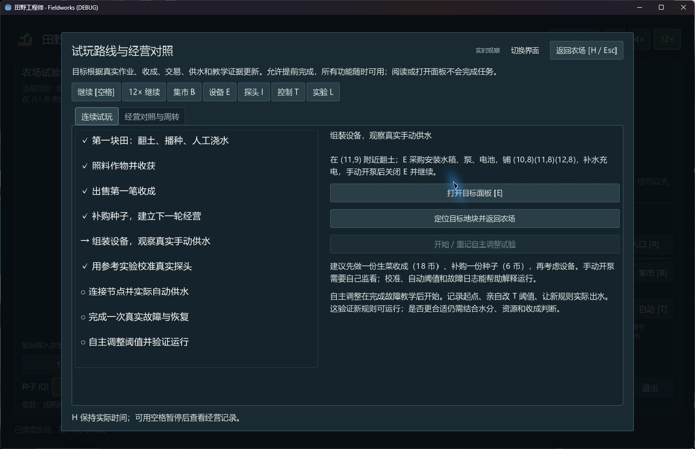

# 2026-10-28 · 玩家视角试玩记录

## 结论与样本边界

种植、收获与销售能形成完整闭环，工程状态与停止原因可以解释，参考校准能产生清楚的前后差异。当前最影响上手的是默认全图尺度、对湿度不作区分的初轮浇水提示，以及进入工程阶段后的信息和操作密度。上述是一次实际操作形成的体验判断，仍需真人新手回访。

操作者为 Codex，通过 computer-use 操作真实 Windows 游戏窗口；已读项目说明，知道系统结构，因此不是完全盲测。未使用自动路线验收器，未把以往测试通过计入本次试玩。

## 环境与隔离

- 基线源码 `a5fad51`；启动前 `main` 与 `origin/main` 同步、工作区干净。
- 使用项目固定 Godot `4.7.2.stable.official.ed1daf0bf`、生产 `scenes/main.tscn`，窗口约 1440×900。日志显示 Compatibility / OpenGL 3.3、NVIDIA RTX 4070 Laptop GPU。
- `tmp/qa/player-playtest-2026-10-28/launch.gd` 仅指定隔离存档，再实例化生产场景；没有修改角色、成熟度、资源、天气或任务。
- 启动普通受限进程未留下可用窗口，随后在正常桌面启动成功；首次应用控制授权超时，重连后可操作。这些属于本次运行环境，不归为游戏玩法缺陷。
- 本次是源码生产场景的桌面体验，没有重新测试或重建独立 Windows 包；引擎与依赖未升级。

## 实际走过的路线

| 阶段 | 实际操作与观察 | 达到的结果 |
| --- | --- | --- |
| 第一块田 | 切近景，在入口可达的 `(8,13)` 翻土、种生菜、浇水 | 种子 12→11，水壶 8→7，第一目标完成 |
| 照料与收获 | 选择 12×，正常时间推进，自然成熟后选择收获工具点击 | 生菜 1 份进入库存，无成熟度注入 |
| 首次经营 | 集市卖 1 份生菜，再买 1 份生菜种子 | 现金 600→618→612，种子回到 12 份，交易记录可见 |
| 基础组装 | 采购并安装 120 L 水箱、节能泵、60 Wh 电池；买 5 管，铺 `(10,8)(11,8)(12,8)`；补满水电 | 花费 252 币，余额 360，管路连通、备用管 2 段 |
| 手动开关 | 打开泵，覆盖区尚未翻土 | 明确显示无可浇翻土地 / 水分上限原因，0 出水；不计为完成供水 |
| 参考实验 | 选黏土 / 接触良好，记录 20% 和 40% 样杯，计算校准并复核 30% 中点 | 中点出厂换算 38.75%，校准后 30.10%；误差 +8.753→+0.098 个百分点，复核达标 |
| 探头与同步 | 未安装时同步被拒绝；到测量台花 40 币采购安装，再回实验同步 | 余额 320，校准同步完成，H 认可实验目标 |
| 节点图 | 花 60 币采购安装控制器，分别拖动端口连两条线，切自动 | 余额 260；节点连接成功，日志提示探头不在出口覆盖的翻土地中，保护停泵 |
| 保存与读回 | 农场暂停后点击保存，再立即读取 | 隔离文件实际写盘并读回，界面保持 260 币 / 120 L / 60 Wh / 自动保护；读档回全图 |

H 实际完成 **5 / 9**：第一块田、收获、销售、补购、参考校准。手动供水、自动供水、故障恢复、自主调整未完成。最终停在第 11 天 06:55、暂停状态；游戏时间包含等待、查看说明与自动化操作间隔，不用于估算真人首轮时长。

## 体验问题与后续建议（尚未实施）

| 优先级 | 实际发现 | 建议与验收方向 |
| --- | --- | --- |
| 高 | 按第一目标浇水时，土壤已是 37.1%；一次浇后升到 49.1%，随即提示过湿、12% 生长速度（当时还受昼夜条件影响，非过湿固定倍率）。照着引导做却变慢，容易误解 | 引导结合当前湿度告诉玩家何时浇；湿润时明确允许等待，并解释人工操作目标。用干燥 / 雨后两类首轮重玩，确认提示与作物状态一致 |
| 高 | 从种一份生菜进入组装，突然要分别采购 / 安装三模块、购管 / 铺管、补水 / 充电 / 开关；实验又同时出现电压、ADC、系数与容差 | 每阶段突出一个下一步、所需条件与预期结果；把详细原理放进可展开区域，保留状态和具体失败原因。让没读 README 的玩家试走一次 |
| 中 | 全图在大面板中央只占较小区域，角色和地块不容易辨认；近景明显更易操作 | 验证开局默认近景、入口高亮或更明确的角色标记；保留全图查看工程的位置关系 |
| 中 | 收获 / 出售有库存、现金、文字与目标勾选反馈，但阶段变化主要仍靠读面板；本次最有成就感的是校准前后数值改善 | 强化首份收成与工程改善的可见结果，让玩家更容易把操作和农场收益联系起来；先验证已有阶段反馈，不在本轮扩展大型玩法 |

值得保留的部分：成功 / 失败原因清楚；价格、库存和流水能对上；采购与安装不重复扣款；无地块可浇和探头位置不符都保护停泵；实验样杯与农场隔离且必须明确同步；H 不因打开面板或连线就虚报任务完成。

## 未解决项与证据限度

- computer-use 发出的空格、F、3、Up 没有观察到相应游戏动作，鼠标和下拉菜单 Esc 可用。代码快捷键依赖 `physical_keycode`，但本次没有采集底层键事件，不能判定根因或宣布真人键盘也失效。
- 因未能通过当前输入移动到上方试验区，没有完成真实手动 / 自动出水、故障演练和自主调整；没有用脚本传送绕过此限制。
- 保存 / 读取仅观察本次隔离槽与界面恢复，不宣称跨进程完整字段、断电、旧版迁移或正式玩家档重新验证。
- 本次未测试声音听感、其他窗口尺寸、独立 release、其他硬件或 Mac；未运行全量自动回归。日志未出现引擎 / 脚本错误，但不是长期稳定性保证。
- 本地过程与现场档为 `tmp/qa/player-playtest-2026-10-28/`；该目录不提交。报告截图为真实窗口原始 JPEG，无重绘或伪造状态。

本次仅产出体验记录、入口补充与原始截图。上述问题未修复，第 14 步验收数字、现有参数、v6 和已交付 ZIP 保持原阶段记录。
